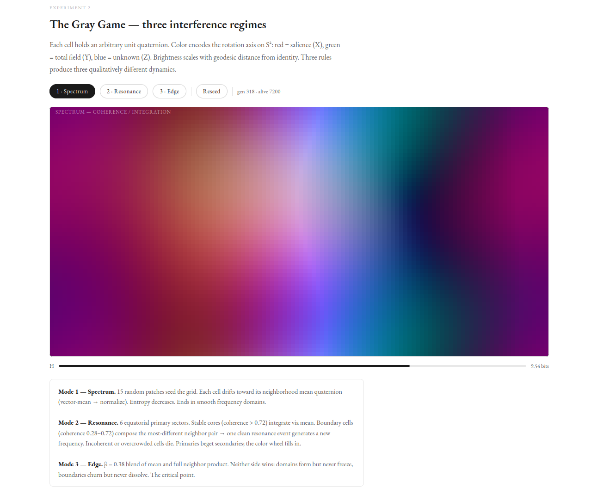
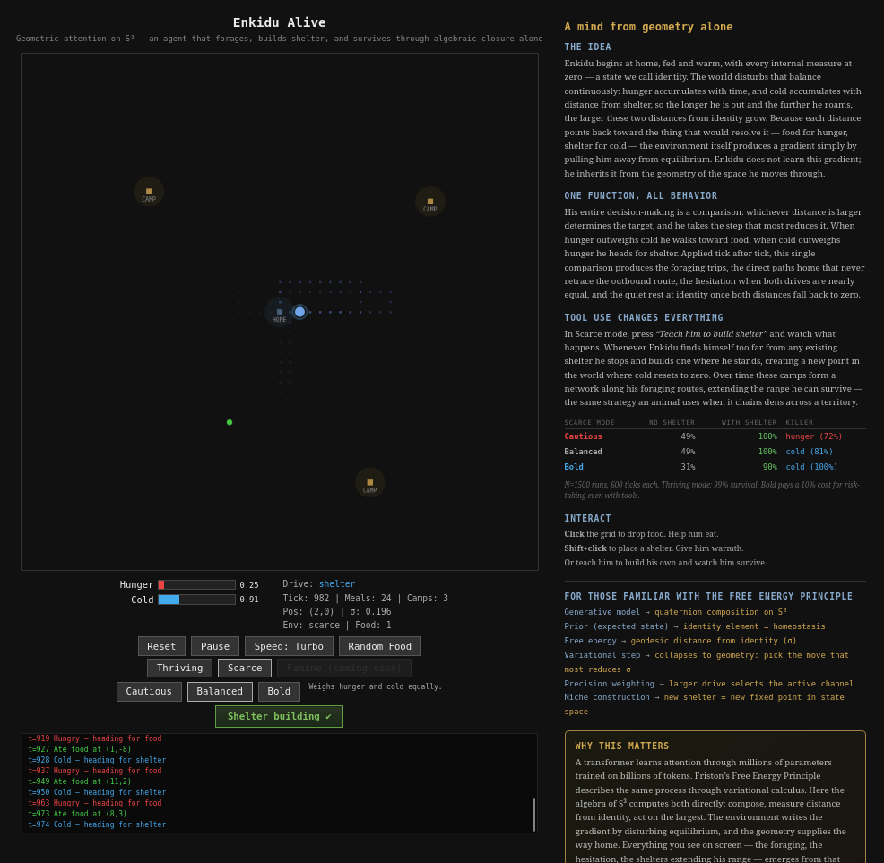

# A Geometric Computer



A complete cognitive architecture built on one manifold, the unit 3-sphere S³,
where every brain state is a unit quaternion and every update is a Hamilton
product, so a single arithmetic operation carries five layers of computation
all the way to Turing completeness.

**Paper:** [A Geometric Computer](GeometricComputer.pdf) · [Zenodo](https://zenodo.org/records/19578024)
**Zeroth Law:** [Sequence Integrity](https://zenodo.org/records/19140055)

---

## What this is

The brain runs a single loop: it ingests a carrier, compares the current state
with what the genome predicts, and measures the geodesic distance σ between
them. When σ crosses π/4, the BKT phase boundary on S³, where the real part
and the vector part of a carrier weigh the same, the brain closes by writing to the genome, updating the hierarchy and
correcting its prediction, so learning is repeated closure and convergence
follows from a fixed-point theorem.

From S³ the architecture builds upward through five layers:

```
substrate → memory → execution → brain → learning
```

Each layer uses only the layer beneath it, and the Hamilton product that
encodes a unit quaternion rotation is the same one that runs a Minsky machine,
reads the genome and integrates the perceptual field, which makes it the whole
arithmetic of the machine.

---

## The paper

[A Geometric Computer](GeometricComputer.pdf) starts from one function,
σ(compose(A, inverse(B))), the geodesic distance from the ground state on S³,
and reads it as the entropy of geometric computation: the same quantity is the
Free Energy Principle's prediction error, the proximity measure for the Riemann
zeros, the branch-on-zero test of a counter machine and the opponent-channel
structure of human trichromatic vision. From that distance the paper derives
the digital brain this repository implements, with perception, evaluation, a
three-layer memory, resonance-based attention, hierarchical abstraction, affect,
neuromodulation and self-observation.

**The living cycle.** Two accumulators run in parallel: Cell A integrates every
carrier as it arrives and holds the picture of the present, while Cell C absorbs
the evaluated outcomes of experience and becomes the brain's model of the world.
The inverse of Cell C is the prediction, the input that would bring the model
home, so before the next input arrives the brain already holds a geometric
answer for what should come, and the distance σ between that prediction and
the incoming carrier is its surprise. Each carrier
that composes into Cell C pulls the model toward what the world delivered, σ
shrinks as the model improves, and the brain comes to rest when Cell C predicts
itself.

**The genome.** Memory is a set of points on S³, where position carries meaning
and distance on the sphere is the index. DNA holds the structural anchors
written once at startup; the epigenetic layer grows from perception each time a
pattern closes strongly enough, while consolidation prunes weak entries and
merges near ones; and the response layer records what each prediction learned
when it met reality, promoting entries that fire together into the categories
that cover them.

**The valence color channels.** The Hopf fibration splits every carrier into a
base point on S², which encodes semantic type, and an angle on the S¹ fibre over
it, which encodes cyclic position; together they carry the three degrees of
freedom of S³. The W-depth, the carrier's real part, reads presence strength,
the same real part that marks a missing record in the noise theorem. One memory
therefore answers four questions,
depending on the coordinate the query uses: the exact carrier (S³), everything
of the same type (S²), everything at the same point in its cycle (S¹), and
everything with the same presence strength (W). The three axes of the base
carry colors with cognitive roles:

| Axis | Color | Role |
|---|---|---|
| Y | green | **Total**: the running aggregate, the full field and the prior |
| Z | blue | **Unknown**: what the brain has yet to integrate |
| X | red | **Salience**: the commutator y₁z₂ − z₁y₂ of Total and Unknown, which the Hamilton product produces by itself |

Salience is the mismatch between what arrived and what was predicted, and the
multiplication deposits it by itself in the X component of every product. What
the brain knows is Green minus Blue, so learned regions glow yellow and novel
ones blue. The retina computes the same three signals from its three cone
types: total luminance (L + M), the boundary between known and unknown
(S − (L + M)), and salience (L − M).

The later sections follow σ through number theory, discrete dynamics, cellular
automata, statistical mechanics and quantum gates, and the experiments below
run those readings on the machine.

---

## Experiments

**[Run in the browser →](https://faltz009.github.io/geometric-brain-experiment/)**
Conway's Game of Life on S³ and the Gray Game, with its three interference
modes, run live in JavaScript in any browser, and the same pages open straight
from [`docs/`](docs/).

The terminal visualizers run in any terminal with true-color support:

```bash
cargo run --example gol_live --release           # Conway's GoL on S³, pattern selector
cargo run --example gray_game_live --release     # Gray Game: spectrum / resonance / edge
```

| # | experiment | subject |
|---|---|---|
| 1 | `exp_arithmetic` | Exact modular arithmetic on S³ for Z/nZ orbits |
| 2 | `exp_bkt_phase_transition` | BKT phase boundary at σ = π/4 |
| 3 | `exp_riemann_zeros` | Riemann zeros as local minima in the carrier field |
| 4 | `exp_associative_memory` | Associative recall by σ-radius |
| 5 | `exp_turing` | Turing completeness via 2-counter Minsky machine |
| 6 | `exp_fractran` | FRACTRAN: Turing-complete prime-native computation |
| 7 | `exp_prime_resonance` | Riemann zeros as prime eigenstates on S³ |
| 8 | `exp_collatz` | Collatz sequence: orbit convergence on the carrier lattice |
| 9 | `exp_fiber_memory` | Fiber memory: axis and angle as independent address channels |
| — | `exp_su2_gates` | SU(2) gate dictionary and single-qubit completeness |
| — | `exp_neuromodulated_learning` | Arousal tracks how disrupted the learning regime is |

---

## Architecture

```
SUBSTRATE
├── sphere      Hamilton product · inverse · sigma · slerp · IDENTITY
├── embed       bytes → carrier on S³ (hashing optional)
├── verify      A?=A · σ · VerificationEvent · Hopf decomposition
└── hopf        S³ → S² with an S¹ fibre · factorized addressing · AddressMode

MEMORY
├── buffer      Transient input window (EMBED writes, ZREAD reads)
├── genome      DNA · Epigenetic · Category · nearest-neighbor reads · BKT control
└── field       zread · resonate · coalition accumulation · cos(σ) falloff

EXECUTION
├── carrier     VerificationCell · EulerPlane · TwistSheet · CouplingState
├── execution   MinskyMachine · FractranMachine · OrbitRuntime
└── zeta        Zeta functions over the carrier lattice

BRAIN
├── hierarchy   Recursive closure detection · genome emission
├── localization O(log n) minimal closure interval search
├── consolidation Merge · prune · reorganize epigenetic · DNA is permanent
├── neuromodulation arousal_tone · coherence_tone (observational, session-ephemeral)
└── three_cell  ThreeCell::ingest → buffer → ZREAD → RESONATE → VERIFY
                → Cell A composition → closure → Cell C integration → genome

LEARNING
└── teach       (input, target) pairs · σ-gap error · geometric convergence
```

---

## Running

```bash
cargo run --example exp_arithmetic --release
cargo run --example exp_fiber_memory --release
cargo run --example gol_live --release
cargo run --example gray_game_live --release

cargo test --release     # 55 tests, all passing
```

---

## What you get

```
Identity maintenance      A?=A at any scale, in one comparison, with σ = 0 at
                          perfect coherence, σ = π/4 where real and vector
                          parts weigh the same, the closure threshold, and
                          σ = π at the mirror, one turn short of home.

Two incident types        A missing record breaks the real axis (W) and a
                          reorder breaks the vector axes (RGB): the two ways a
                          composition on S³ can break.

Carrier channels          R = salience (X), the [Total, Unknown] commutator.
                          G = total (Y), the full field and the prior.
                          B = unknown (Z), what the brain has yet to integrate.
                          Known = G − B, so yellow is learned and blue is novel.

Factorized addressing     Axis queries find semantic type (S²), angle queries
                          find cyclic position (S¹), and full queries find the
                          exact carrier (S³).

Field resonance           ZREAD reads the genome by proximity on the sphere,
                          with query strength falling as cos(σ) and cutting off
                          at σ = π/3.

Genome persistence        The DNA layer bootstraps from orbit seeds and stays
                          permanent; the epigenetic layer learns from ingest
                          and consolidates.

Turing completeness       A 2-counter Minsky machine and FRACTRAN run on the
                          carrier substrate.

BrainState serialization  The full state serializes to JSON with an exact
                          round trip.
```

---

## Enkidu-Alive



An agent whose position is a unit quaternion on S³, with home at IDENTITY, so
the algebraic identity element is homeostasis and σ, his geodesic angle from
home, is a geometric prediction error; in the Python version σ is his cold
drive. Two drives, hunger and cold, rise while he is out and reset at food and
shelter, and each tick is a single comparison in which the larger drive sets
the target and a grid step carries him toward it. The
[Enkidu-Alive README](demos/enkidu_alive/README.md) sets the geometry and the
game rules side by side.

**[Try it live →](https://faltz009.github.io/geometric-brain-experiment/enkidu.html)**
The Python version, with its tests, is in [`demos/enkidu_alive/`](demos/enkidu_alive/).

---

## What's in this repo

| Path | What it is |
|---|---|
| `src/` | The Geometric Computer, the Rust crate `closure_ea` with the five layers above |
| `examples/` | Every experiment in the table, plus the two terminal visualizers |
| `docs/` | The browser experiments: Game of Life, the Gray Game and Enkidu-Alive |
| `demos/enkidu_alive/` | Enkidu-Alive in Python, with its tests |
| `GeometricComputer.pdf` | The paper |

---

## Tests

```bash
cargo test --release                                   # 55 tests
```

The Python demo's setup and tests are in its [README](demos/enkidu_alive/README.md).

---

## Support

Independent research, done on personal time and released for free.

| Method | Address |
|---|---|
| Ko-fi | [ko-fi.com/waltersilva](https://ko-fi.com/waltersilva) |
| BTC | `155jaKugGGhdwX2Dp55bfHWpWbWD3Gr3PG` |
| ETH (ERC-20) | `0x31f0253180b03c16a0aa2d7091311d7363ef22a4` |
| SOL | `HdGFaL6A8z8AetnyPn6vKPU4QJGaSHBtoqPK32qbe6wV` |
| PIX (Brazil) | `walter.h057@gmail.com` |

## License

AGPL-3.0-only
